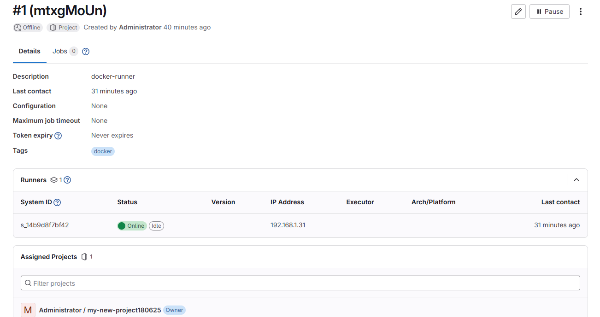
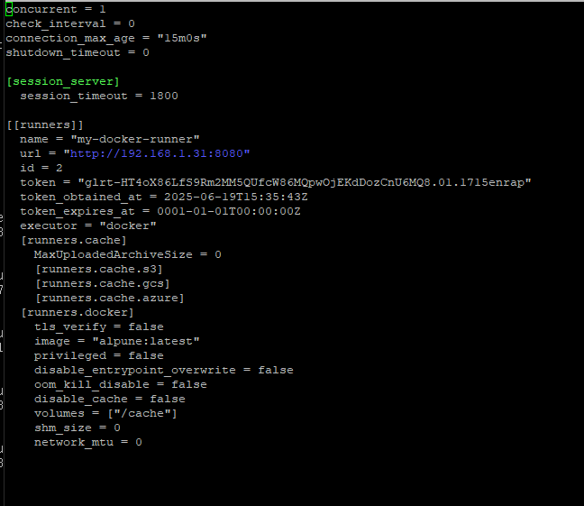
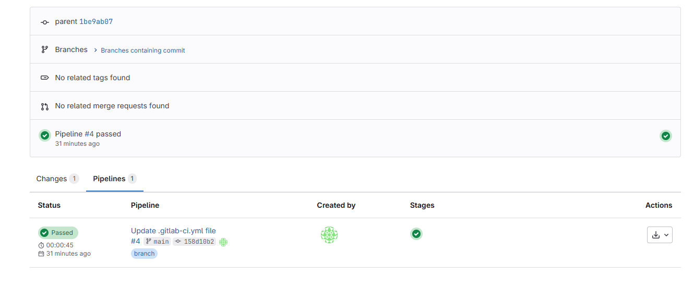

# Решение по задаче "`GitLab`"

     
---

### Задание 1


1. `Скачиваем gitlab-cc и понимаем, что недостаточно места на диске.`
2. `Расширяем диск`
3. `Установка gitlab-cc`
4. `Изменение external_url в gitlab.rb под собственный ip и порт`
5. `Отбираем порт 8080 у jankins/java`
6. `Очень долгая загрузка страницы, проверка логов, смена портов puma`
7. `Успешныая загрузка http-страницы`
8. `Создание проекта "my-new-project180625"`
9. `Установка gitlab-runner и регистрация`

`На скриншоте с ативностью runner и его конфигам - разные т.к. предыдущий был удалён до сохранения настроек и был пересоздан`

`При необходимости прикрепитe сюда скриншоты
![runner.png] 
![config.toml.png] 

---

### Задание 2

`Приведите ответ в свободной форме........`

1. `Загружаем репозиторий меняем origin и пушем на gitlab`
2. `Создаём .gitlab-ci.yml для теста`
3. `Ловим ошибку и идём проверять runner`
4. `Повторно запускаем pipline отключив Auto DevOps`
5. `Успех`

```
stages:
  - test
test-job:
  stage: test
  image: alpine
  script:
    - echo "Test project file <3"
    - ls -la
    - echo "Create .txt file for artifacts" > test.txt
  artifacts:
    paths:
      - test.txt
    expire_in: 1 hour
```

![pipline.png] 


---
